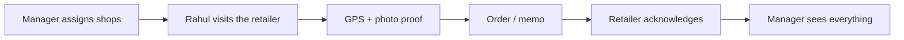
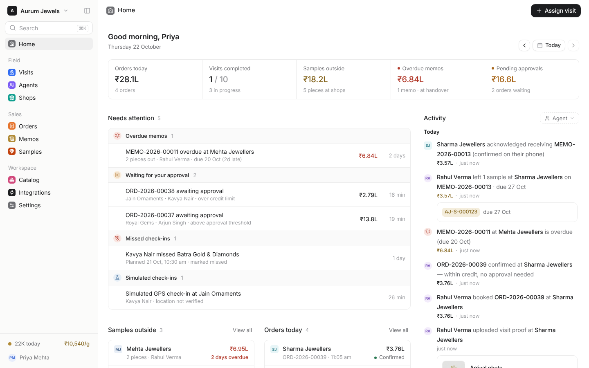
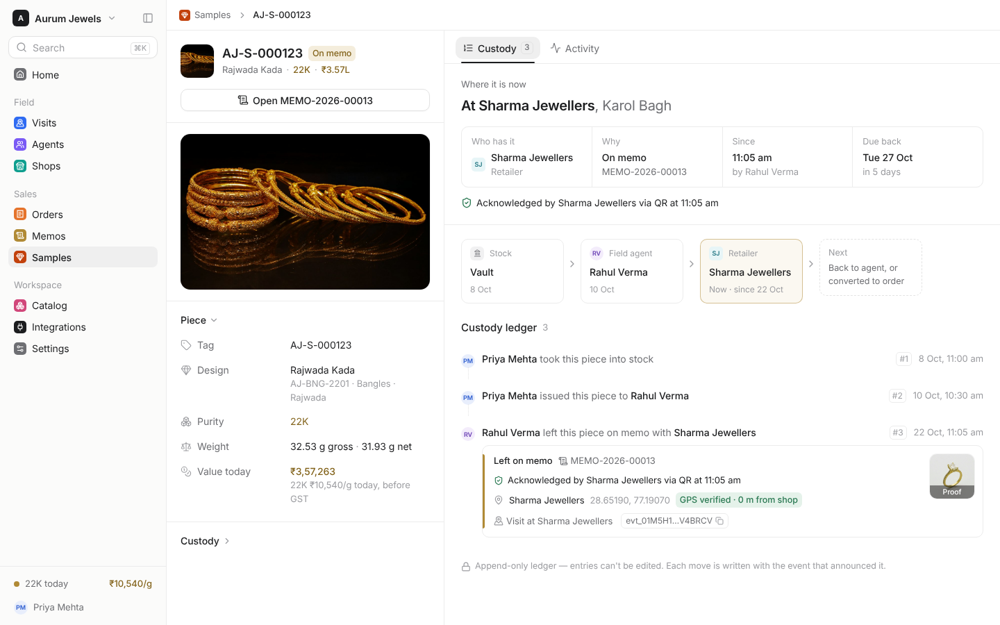
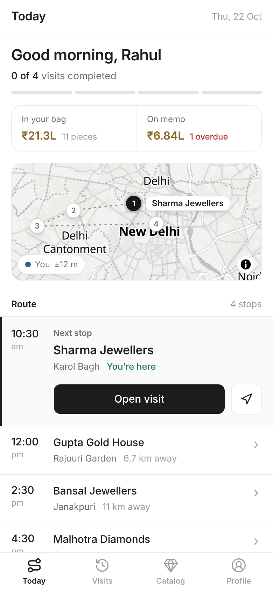
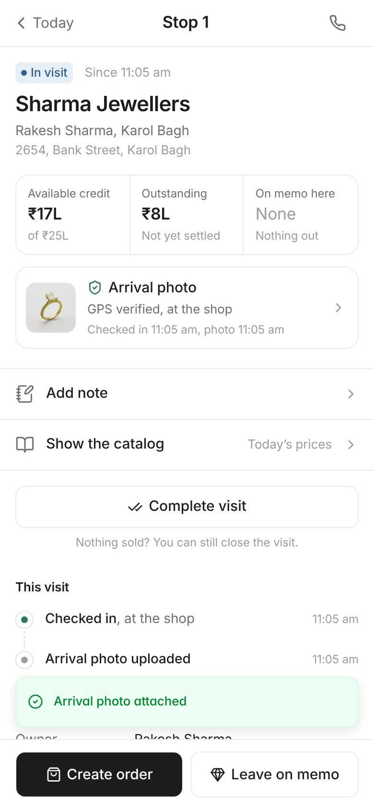
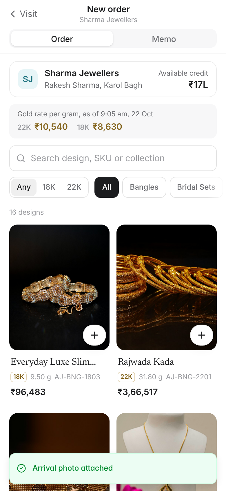
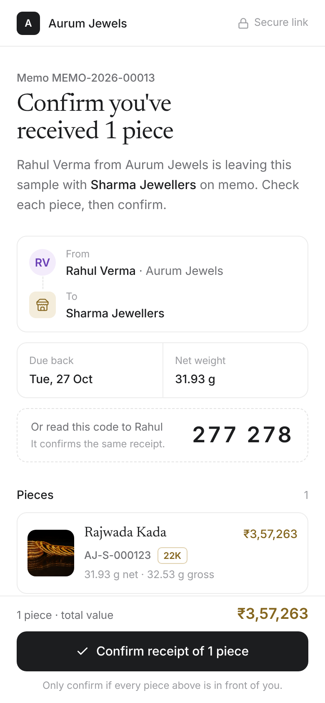
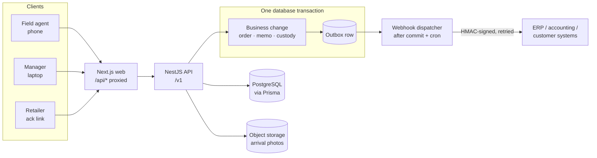

# JewelRoute

**Know where every salesman went, what they sold, and where every gram of jewellery is.**

JewelRoute is a multi-tenant field-sales system for jewellery manufacturers and wholesalers. A business signs up and gets its own workspace. Its managers set the daily gold rate, tag sample pieces and plan routes. Field agents then visit retailers with those pieces:
- each check-in is verified by GPS and an arrival photo;
- orders are priced at today's gold rate;
- pieces left on memo are acknowledged by the retailer;
- every piece has an immutable custody ledger.

**Live:** [jewelroute.vercel.app](https://jewelroute.vercel.app)

## Product overview



<table>
<tr>
<td width="34%"><b>Field flow</b>: Today → Sharma Jewellers → check-in → photo → order → memo<br></td>
<td width="66%"><b>Manager flow</b>: Home → order → memo → sample custody<br></td>
</tr>
</table>

Full quality: [field-flow.mp4](docs/assets/readme/field-flow.mp4) · [manager-flow.mp4](docs/assets/readme/manager-flow.mp4). Everything here was captured from the running app with the seeded demo data.

### Manager

| Home: what needs attention, live activity | Sample custody: where the piece is, who has it, why, and when it's due back |
|---|---|
|  |  |

### Field agent and retailer (phone)

| Today | Active visit (GPS + photo) | Sale at today's gold rate | Retailer acknowledgement |
|---|---|---|---|
|  |  |  |  |

## Core features

- **GPS + photo verified visits.** The server checks the shop's geofence before accepting a check-in, and a sale needs an arrival photo first.
- **Live gold-rate catalogue.** Prices come from today's rate per purity, and every order freezes that rate and price.
- **Orders with approval rules.** An order goes to the manager only when it would cross the shop's credit limit or the approval threshold, and the server decides.
- **Memo + retailer acknowledgement.** Pieces left with a retailer are confirmed on the retailer's own phone, by QR or a 6-digit code.
- **Physical sample custody ledger.** Every piece has exactly one holder at a time — vault, agent, shop or sold — recorded in an append-only ledger.
- **Signed webhooks.** Each change is published as an HMAC-signed event for ERP or accounting systems, retried with backoff, with a dead letter.

## Tech stack

| | |
|---|---|
| **Frontend** | Next.js 15.5, React 19.1, TypeScript, Tailwind 4, shadcn/Radix, TanStack Query 5, MapLibre GL 5 (OpenFreeMap tiles) |
| **Backend** | NestJS 11, Prisma 6.19, PostgreSQL 16 |
| **Infrastructure** | Vercel; Vercel Blob for photos (Postgres fallback locally); PostgreSQL transactional outbox; HMAC-signed webhooks |
| **Testing** | API integration tests on real Postgres, Playwright browser E2E plus a route-and-control crawler, a 31-step end-to-end scenario |

## System design



- **Server-side geofence.** The API recomputes the distance from the shop's saved coordinates; the phone's own answer is never trusted. Simulated GPS exists only for demo workspaces and is always labelled.
- **Transactional custody.** Each piece move locks rows in a fixed order and appends a ledger entry in the same transaction. Database constraints keep one holder per piece, and a piece on at most one open memo.
- **Immutable snapshots.** Order lines and gold rates are append-only: database triggers block edits, so a historical price never changes.
- **Idempotent writes.** Orders, memos and check-ins require an `Idempotency-Key`, so a retry replays the original result and never creates a duplicate.
- **Transactional outbox.** The event row commits with the business change, then it's delivered at least once with signatures and backoff.

## Repository

```
apps/web         Next.js app: landing, /signup, /login, /field/*, /admin/*, /ack/:token, /developers
apps/api         NestJS API, Prisma schema and migrations, tests
packages/shared  pricing, credit, geofence, dates, event catalogue (shared by both apps)
docs             API contract, design system, decisions, reviews
```

## Run locally

Requires Node 22 and PostgreSQL 16; the script uses a running Postgres, Docker, or installs Postgres with Homebrew on a Mac.

```bash
./scripts/run-local.sh --prod       # installs, migrates, seeds the demo; web :3000, API :4000 (Swagger /docs)
pnpm verify                         # unit + API integration tests, typecheck, lint
cd apps/web && pnpm e2e             # Playwright against the running app
```

## Demo

[jewelroute.vercel.app](https://jewelroute.vercel.app), or run it locally. The login page has one-tap demo buttons.

| Role | Login |
|---|---|
| Rahul, field agent (open at phone width) | `rahul@aurum.test` / `Rahul@2026` |
| Priya, manager | `admin@aurum.test` / `Aurum@2026` |

More: [HANDOVER.md](HANDOVER.md) · [API contract](docs/CONTRACT.md) · [Design decisions](docs/DECISIONS.md)
